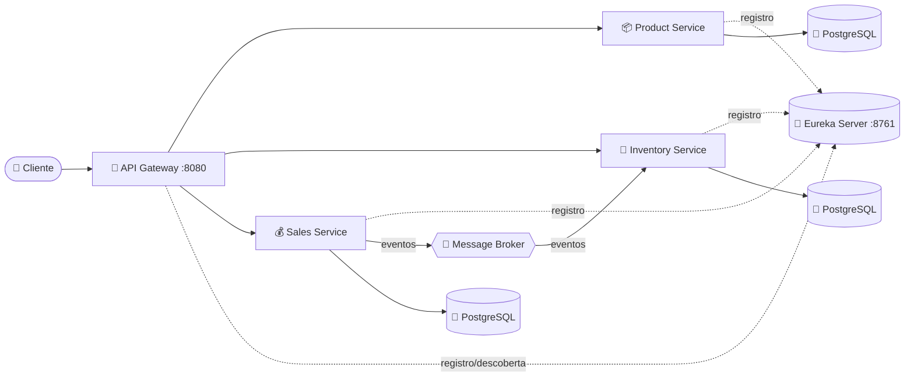

# 🛒 E-commerce Microservices

Plataforma de e-commerce construída com **arquitetura de microsserviços** usando **Java 21** e **Spring Boot**. O projeto está em **fase inicial** e tem como objetivo praticar e demonstrar boas práticas de sistemas distribuídos: separação por domínio, descoberta de serviços, API Gateway e comunicação assíncrona entre serviços.

> 🚧 **Status:** em desenvolvimento. A estrutura base está pronta e os serviços de negócio estão sendo construídos um a um.

---

## 🎯 Ideia do projeto

Em vez de uma aplicação monolítica, o e-commerce é dividido em serviços pequenos e independentes, cada um responsável por uma parte do negócio:

- 📦 **Product Service** cuida do catálogo de produtos (nome, descrição, SKU, preço e status)
- 🏬 **Inventory Service** controla o estoque dos produtos
- 💰 **Sales Service** registra e processa as vendas
- 🚪 **API Gateway** é o ponto único de entrada para os clientes
- 🧭 **Service Discovery (Eureka)** permite que os serviços se encontrem sem endereços fixos

Os serviços se comunicam de forma **síncrona** (via Gateway/HTTP) e, futuramente, de forma **assíncrona** por mensageria (ex.: uma venda realizada gera um evento para baixar o estoque).

---

## 🏗️ Arquitetura



### 🔀 Rotas do Gateway

| Rota | Serviço de destino |
|------|--------------------|
| `/api/products/**` | `PRODUCT-SERVICE` |
| `/api/inventory/**` | `INVENTORY-SERVICE` |
| `/api/sales/**` | `SALES-SERVICE` |

---


### 🔌 Portas

| Serviço | Porta |
|---------|-------|
| 🧭 Service Discovery (Eureka) | `8761` |
| 🚪 API Gateway | `8080` |
| 📦 Product Service | `8081` |
| 🏬 Inventory Service | `8082` |
| 💰 Sales Service | `8083` |

---

## 🧰 Tecnologias

| Categoria | Tecnologia |
|-----------|-----------|
| 💻 Linguagem | Java 21 |
| 🌱 Framework | Spring Boot 4.1.2 |
| ☁️ Microsserviços | Spring Cloud (Gateway, Eureka, LoadBalancer) |
| 🗄️ Persistência | Spring Data JPA + PostgreSQL |
| ✅ Validação | Spring Validation |
| 📨 Mensageria | RabbitMQ *(em avaliação: **Apache Kafka**)* |
| 🐳 Infraestrutura | Docker *(planejado)* |
| 🔧 Build | Maven (Maven Wrapper incluso) |

---

## 📁 Estrutura do projeto

```
ecommerce-microservices/
├── 🧭 service-discovery/    # Eureka Server
├── 🚪 api-gateway/          # Spring Cloud Gateway
├── 📦 product-service/      # Catálogo de produtos
├── 🏬 inventory-service/    # Controle de estoque
├── 💰 sales-service/        # Vendas
├── 📚 docs/architecture/    # Documentação de arquitetura
└── 🐳 infrastructure/       # Docker e banco de dados
```

### 🧱 Organização interna dos serviços

O `product-service` segue uma abordagem de **DDD pragmático**, dividido em camadas:

```
com.ecommerce.product_service
├── domain          # Regras de negócio puras (entidades, value objects, exceções, contratos de repositório)
├── application     # Casos de uso
├── infrastructure  # Implementações técnicas (JPA, mensageria, configurações)
└── interfaces      # Entrada da aplicação (controllers REST, DTOs)
```

Destaques do domínio já implementado:
- 🏷️ `Product` é uma entidade rica, com regras de validação e comportamentos (`updateDetails`, `changePrice`, `activate`, `deactivate`)
- 🔖 `Sku` é um *value object* (record) que normaliza e valida o código do produto
- 📜 `ProductRepository` é um contrato definido no domínio, independente de tecnologia

---

## 🗺️ Roadmap

- [x] ✅ Estrutura multi-módulo com Maven
- [x] ✅ Service Discovery com Eureka
- [x] ✅ API Gateway com rotas para os serviços
- [x] ✅ Modelo de domínio do Product Service
- [ ] 🚧 Camadas de aplicação, infraestrutura e interfaces do Product Service
- [ ] 🚧 Persistência com PostgreSQL
- [ ] 📅 Docker Compose (bancos de dados e infraestrutura)
- [ ] 📅 Inventory Service
- [ ] 📅 Sales Service
- [ ] 📅 Comunicação assíncrona entre serviços (RabbitMQ ou Kafka)
- [ ] 📅 Testes automatizados
- [ ] 📅 Documentação da API (OpenAPI/Swagger)
- [ ] 📅 Observabilidade (logs, métricas e tracing)

---

## ▶️ Como executar

### Pré-requisitos

- ☕ JDK 21
- 📦 Maven (ou use o `mvnw` incluso em cada módulo)

### Passo a passo

Suba os módulos **nesta ordem**, cada um em um terminal:

```bash
# 1️⃣ Service Discovery (http://localhost:8761)
cd service-discovery
./mvnw spring-boot:run

# 2️⃣ API Gateway (http://localhost:8080)
cd api-gateway
./mvnw spring-boot:run

# 3️⃣ Demais serviços (um terminal para cada)
cd product-service    # http://localhost:8081
./mvnw spring-boot:run

cd inventory-service  # http://localhost:8082
./mvnw spring-boot:run

cd sales-service      # http://localhost:8083
./mvnw spring-boot:run
```

> 💡 No Windows, use `mvnw.cmd` no lugar de `./mvnw`.

Depois de subir, acesse o painel do Eureka em `http://localhost:8761` para ver os serviços registrados.

---

## 👨‍💻 Autor

**Lucas Bonan**
Estudante de Engenharia de Software 🎓

---

⭐ Projeto em evolução, sugestões e feedbacks são bem-vindos!
